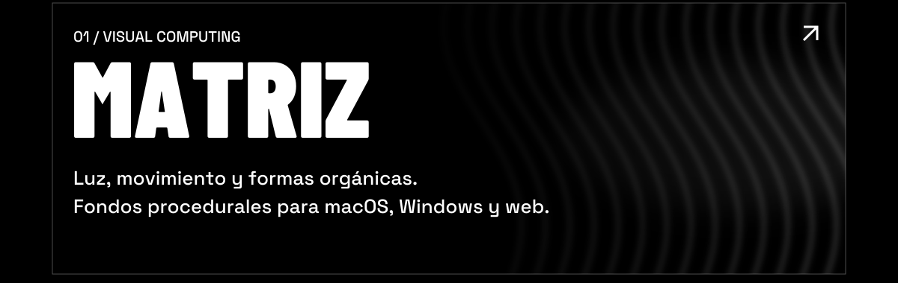

<picture>
  <source media="(max-width: 800px)" srcset="assets/hero-mobile.svg">
  
</picture>

  
  
  
  

<picture>
  <source media="(max-width: 800px)" srcset="assets/about-mobile.svg">
  
</picture>

<picture>
  <source media="(max-width: 800px)" srcset="assets/work-mobile.svg">
  
</picture>

<a href="https://github.com/jesusjodar/Matriz">
  <picture>
    <source media="(max-width: 800px)" srcset="assets/matriz-mobile.svg">
    
  </picture>
</a>

<a href="https://jesusjodar.github.io">
  <picture>
    <source media="(max-width: 800px)" srcset="assets/portfolio-mobile.svg">
    
  </picture>
</a>

<a href="https://github.com/jesusjodar?tab=overview">
  <picture>
    <source media="(max-width: 800px)" srcset="assets/activity-mobile.svg">
    
  </picture>
</a>

Ver perfil en texto

### Jesús Jódar

Desarrollo, investigación y diseño de interfaces de nueva generación.

Combino desarrollo de software, automatización y diseño 3D para convertir ideas en experiencias. Me interesan los agentes con memoria y herramientas, los modelos locales, las interfaces expresivas y las tecnologías emergentes.

**Intereses:** IA local · agentes · interfaces · ecosistema Apple · Blender · videojuegos.

- [Matriz](https://github.com/jesusjodar/Matriz): fondos procedurales para macOS, Windows y web.
- [Portfolio](https://jesusjodar.github.io): diseño, desarrollo e ideas.
- [Actividad en GitHub](https://github.com/jesusjodar?tab=overview).
- [LinkedIn](https://www.linkedin.com/in/jesujopi) · [Instagram / 3D](https://www.instagram.com/jesujopi) · [Correo](mailto:jesusjodarpiernas@gmail.com).

